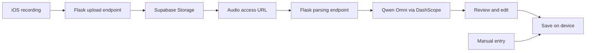

# VoiceAccount

**Speak your expenses. Let AI organize the entries.**

[简体中文](README.md) · English

VoiceAccount is an iOS expense tracker built around voice input. Describe one or several purchases naturally, and AI extracts the amounts, titles, and categories. Review and edit the entries before saving, then explore your spending through statistics and searchable history.

The app combines a native SwiftUI dark interface with a Flask backend for audio uploads and AI parsing. Manual entry is also available for everyday use.

> This repository is an application prototype for learning and further development. The app interface and parsing prompt primarily use Chinese, and amounts are treated as Chinese yuan (CNY). Bilingual documentation does not imply a bilingual app interface.

## Example

Say, in Chinese:

> “今天午饭花了 32 元，打车 18 元，买咖啡 15 元。”
>
> “I spent 32 yuan on lunch, 18 on a taxi, and 15 on coffee today.”

The expected entries might look like this (illustrative only; actual results depend on the model):

| Title | Amount | Category |
| --- | ---: | --- |
| 午饭 (Lunch) | ¥32.00 | 餐饮 (Food & dining) |
| 打车 (Taxi) | ¥18.00 | 交通 (Transport) |
| 咖啡 (Coffee) | ¥15.00 | 餐饮 (Food & dining) |

Results appear as editable drafts. Check the amount, title, category, date, and time before saving.

## Features

- **Voice entry:** Record `.m4a` audio and use AI to extract multiple expenses, assigning categories from your current category list.
- **Review before saving:** Edit amounts, titles, categories, dates, and times, or remove unwanted drafts.
- **Manual entry:** Add an expense directly without calling the voice backend.
- **Spending statistics:** View current-month or current-year totals, spending trends, and category rankings.
- **Searchable history:** Browse entries grouped by date, search by title, category, amount, or date and time, and delete records.
- **Category management:** Create, edit, and delete categories, with customizable icons and colors.
- **Local storage and export:** Keep records and categories on the device, export CSV files, and reset local data.
- **Native dark interface:** Four main tabs for entry, statistics, history, and settings.

## How it works



AVFoundation handles recording. The backend stores audio in the Supabase Storage `user-audio` bucket, then calls `qwen-omni-turbo` through DashScope's OpenAI-compatible API to extract `amount`, `title`, and `category`. The client turns the response into editable drafts.

| Component | Technology |
| --- | --- |
| iOS client | Swift, SwiftUI, AVFoundation |
| Expense persistence | Codable / JSON + UserDefaults |
| Backend | Python, Flask |
| Audio storage | Supabase Storage |
| AI parsing | DashScope, Qwen Omni, OpenAI Python SDK |
| UI prototypes | HTML, CSS |

## Project structure

```text
VoiceAccountClient/
├── VoiceAccount.xcodeproj/       # Xcode project
├── AppInfo.plist                 # Microphone and local-network permissions
├── VoiceAccount/
│   ├── ContentView.swift        # Views, recording, API calls, local storage
│   ├── VoiceAccountApp.swift    # App entry point
│   └── Assets.xcassets/         # Icons and colors
└── prototype/                   # HTML / CSS UI prototypes
VoiceAccountServer/
├── app.py                       # Flask endpoints and AI parsing
├── requirements.txt             # Python dependencies
└── .env.example                 # Environment variable template
```

## Run locally

### 1. Get the code

```bash
git clone https://github.com/SU9270/VoiceAccount.git
cd VoiceAccount
```

The iOS app requires macOS and Xcode. The project's current deployment target is **iOS 26.5**. Use Xcode and a device or simulator that support this target; compatibility with earlier versions requires changes and verification.

The backend needs Python 3, a Supabase project, and a DashScope API key with access to the configured model. The repository does not declare a minimum Python version; use an environment compatible with its pinned dependencies.

### 2. Configure and start the backend

```bash
cd VoiceAccountServer
python3 -m venv .venv
source .venv/bin/activate
python -m pip install -r requirements.txt
cp .env.example .env
```

Edit `.env`:

```dotenv
SUPABASE_URL=https://your-project.supabase.co
SUPABASE_SERVICE_ROLE_KEY=your-service-role-key
DASHSCOPE_API_KEY=your-dashscope-api-key
```

Create a Supabase Storage bucket named `user-audio`. The backend generates signed URLs valid for seven days so the model can access recordings; the bucket does not need to be public.

```bash
python app.py
```

The development server listens on `0.0.0.0:5000`. In another terminal, run:

```bash
curl http://127.0.0.1:5000/
```

The expected response is `Hello Flask`. This checks HTTP reachability only, not storage uploads or model access.

### 3. Configure and run the iOS app

From the repository root:

```bash
open VoiceAccountClient/VoiceAccount.xcodeproj
```

Check the `baseURL` in **both** services in `VoiceAccountClient/VoiceAccount/ContentView.swift`:

- `AudioUploadService`
- `AudioParseService`

The simulator branch defaults to `http://127.0.0.1:5000`. The physical-device branch defaults to `http://192.168.1.2:5000`. Replace both physical-device addresses with the backend computer's actual LAN IP, and ensure the phone can reach port 5000 on that computer.

Select your signing team and target device in Xcode, run the app, and grant microphone and local-network access when prompted. Open the voice entry screen, finish recording, review the parsed drafts, and save.

Manual entry, local history, statistics, and CSV export do not require the backend.

## Backend API

| Method | Endpoint | Purpose |
| --- | --- | --- |
| GET | `/` | Returns `Hello Flask` for an HTTP reachability check |
| POST | `/upload-audio` | Accepts an `.m4a` file in multipart field `audio`; returns a storage path and access URLs |
| POST | `/parse-audio-expenses` | Accepts `audio_url` and a nonempty `categories` array; returns parsed `items` |
| GET | `/supabase-test` | Debug connection check that counts users through the admin API |

Parsing request structure:

```json
{
  "audio_url": "<url returned by the upload endpoint>",
  "categories": ["餐饮", "交通", "购物", "其他"]
}
```

Each returned item contains `amount`, `title`, and `category`. Categories can also be objects with `name`, `icon`, and `colorHex`, as sent by the iOS client.

## Data handling and current limitations

- **Records are local; voice processing is online.** Expenses and categories are stored in UserDefaults. Voice entry uploads recordings to Supabase and sends their URLs to DashScope for model processing.
- **Local reset does not delete cloud recordings.** Resetting removes local records and custom categories and restores defaults. Uploaded audio remains in Supabase; automatic cloud-audio cleanup is not implemented.
- **The current scope is expenses.** Income tracking, multiple currencies, account sign-in, and cross-device ledger sync are not implemented. Voice drafts default to the current date and time, which you can adjust before saving.
- **Category management has prototype behavior.** Missing default categories are restored at launch, so deleting or renaming a default category may cause its original name to reappear after restarting.
- **The backend uses development settings.** Flask debug mode is enabled, and endpoints do not implement user authentication or rate limiting. Add these controls and HTTPS before public deployment, and keep server credentials exclusively on the backend.
- **No license has been specified.** The repository currently has no `LICENSE` file.

## Feedback

Report bugs and suggestions through [Issues](https://github.com/SU9270/VoiceAccount/issues), or submit a pull request. For parsing issues, include a description of the input with personal information removed, the expected result, and the actual result.
