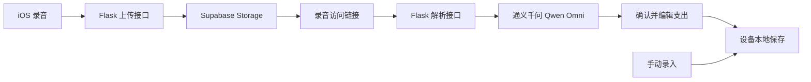

# VoiceAccount · 语音记账

**把日常开销说出来，让 AI 帮你整理成账。**

简体中文 · [English](README.en.md)

VoiceAccount 是一款以语音输入为核心的 iOS 支出记账应用。用自然语言说出一笔或多笔消费，AI 会提取金额、标题和分类；你可以在保存前逐条确认、修改，再通过统计和历史记录了解自己的开销。

项目采用 SwiftUI 构建原生深色界面，使用 Flask 提供录音上传和 AI 解析服务，同时保留手动记账入口，方便在不同场景下记录支出。

> 当前仓库是供学习和继续开发的应用原型。应用界面及语音解析提示词以中文为主，金额按人民币处理；中英文 README 不代表应用已经支持双语界面。

## 使用场景

例如，说出：

> “今天午饭花了 32 元，打车 18 元，买咖啡 15 元。”

预期可整理成以下三笔记录（仅为示例，实际结果取决于模型识别）：

| 标题 | 金额 | 分类 |
| --- | ---: | --- |
| 午饭 | ¥32.00 | 餐饮 |
| 打车 | ¥18.00 | 交通 |
| 咖啡 | ¥15.00 | 餐饮 |

识别结果会先进入编辑界面。核对金额、标题、分类和日期时间后，再保存到账本。

## 功能

- **语音记账**：录制 `.m4a` 音频，上传后由 AI 提取一笔或多笔支出，并从当前分类中选择类别。
- **保存前确认**：编辑识别结果的金额、标题、分类及日期时间，也可以删除不需要的条目。
- **手动记账**：直接填写金额、标题、时间和分类，无需调用语音服务。
- **支出统计**：查看本月或本年总支出、趋势图和按金额排序的分类分布。
- **历史查询**：按日期分组浏览记录，按标题、分类、金额或日期时间搜索，并删除记录。
- **分类管理**：内置餐饮、交通、购物等分类，支持新增、编辑、删除，以及自定义图标和颜色。
- **本地保存与导出**：账目及分类保存在设备本地，支持 CSV 导出和清空本地数据。
- **原生深色界面**：围绕「记账、统计、历史、设置」四个页面组织日常操作。

## 工作原理



客户端使用 AVFoundation 录音。后端把音频保存至 Supabase Storage 的 `user-audio` bucket，再通过 DashScope 的 OpenAI 兼容接口调用 `qwen-omni-turbo`，提取 `amount`、`title` 和 `category`。客户端将返回结果转换为可编辑草稿。

| 部分 | 技术 |
| --- | --- |
| iOS 客户端 | Swift、SwiftUI、AVFoundation |
| 账目持久化 | Codable / JSON + UserDefaults |
| 后端 | Python、Flask |
| 音频存储 | Supabase Storage |
| AI 解析 | DashScope、Qwen Omni、OpenAI Python SDK |
| 界面原型 | HTML、CSS |

## 目录结构

```text
VoiceAccountClient/
├── VoiceAccount.xcodeproj/       # Xcode 工程
├── AppInfo.plist                 # 麦克风及本地网络权限声明
├── VoiceAccount/
│   ├── ContentView.swift        # 页面、录音、接口调用及本地存储
│   ├── VoiceAccountApp.swift    # 应用入口
│   └── Assets.xcassets/         # 图标与颜色资源
└── prototype/                   # HTML / CSS 界面原型
VoiceAccountServer/
├── app.py                       # Flask 接口及 AI 解析逻辑
├── requirements.txt             # Python 依赖
└── .env.example                 # 环境变量模板
```

## 本地运行

### 1. 获取代码

```bash
git clone https://github.com/SU9270/VoiceAccount.git
cd VoiceAccount
```

iOS 客户端需要 macOS 和 Xcode。当前工程的 Deployment Target 为 **iOS 26.5**，请使用支持该目标的 Xcode 和设备或模拟器；若要兼容更低版本，需要自行调整并验证。

后端需要 Python 3 环境，以及可用的 Supabase 项目和具备相应模型访问权限的 DashScope API Key。仓库未单独声明 Python 最低版本，请选择能够安装下述固定版本依赖的环境。

### 2. 配置并启动后端

```bash
cd VoiceAccountServer
python3 -m venv .venv
source .venv/bin/activate
python -m pip install -r requirements.txt
cp .env.example .env
```

编辑 `.env`：

```dotenv
SUPABASE_URL=https://your-project.supabase.co
SUPABASE_SERVICE_ROLE_KEY=your-service-role-key
DASHSCOPE_API_KEY=your-dashscope-api-key
```

在 Supabase Storage 中创建名为 `user-audio` 的 bucket。后端会生成有效期为 7 天的签名链接供模型读取录音，无需为此将 bucket 设为公开。

```bash
python app.py
```

开发服务器默认监听 `0.0.0.0:5000`。在另一个终端执行：

```bash
curl http://127.0.0.1:5000/
```

预期返回 `Hello Flask`。此检查只验证 HTTP 服务可达，不代表音频上传或模型调用已验证成功。

### 3. 配置并运行 iOS 客户端

从仓库根目录打开工程：

```bash
open VoiceAccountClient/VoiceAccount.xcodeproj
```

在 `VoiceAccountClient/VoiceAccount/ContentView.swift` 中检查 **两个**服务的 `baseURL`：

- `AudioUploadService`
- `AudioParseService`

模拟器分支默认使用 `http://127.0.0.1:5000`。真机分支默认使用 `http://192.168.1.2:5000`，请将两处地址都改为运行后端的电脑在局域网中的实际 IP，并确保手机能访问该电脑的 5000 端口。

在 Xcode 中选择签名团队及运行设备，启动应用，按提示允许麦克风和本地网络访问。进入「记账 → 语音记账」，录音结束后等待识别，确认条目并保存。

仅体验手动记账、本地查询、统计和导出时，无需启动后端。

## 后端接口

| 方法 | 路径 | 用途 |
| --- | --- | --- |
| GET | `/` | 返回 `Hello Flask`，用于检查服务可达性 |
| POST | `/upload-audio` | 以 multipart 表单字段 `audio` 上传 `.m4a` 文件，返回存储路径和访问链接 |
| POST | `/parse-audio-expenses` | 接收 `audio_url` 和非空 `categories` 数组，返回解析后的 `items` |
| GET | `/supabase-test` | 调试用连接检查，调用管理员接口统计用户数量 |

解析接口的请求结构：

```json
{
  "audio_url": "<上传接口返回的 url>",
  "categories": ["餐饮", "交通", "购物", "其他"]
}
```

每个返回条目包含 `amount`、`title`、`category`。分类也可以用包含 `name`、`icon`、`colorHex` 的对象传入，客户端采用这种形式。

## 数据与当前边界

- **账目本地保存，语音需要联网。** 账目和分类通过 UserDefaults 保存在设备上；使用语音功能时，录音会上传至 Supabase，并由 DashScope 模型读取处理。
- **本地清除不等于云端删除。** 「清除所有数据」会移除本地账目和自定义分类、恢复默认分类，不会删除 Supabase 中已上传的录音；当前未实现云端录音自动清理。
- **当前专注支出。** 尚未实现收入记账、多币种、账户登录或跨设备账本同步。语音条目的日期时间默认取当前时间，可在保存前手动调整。
- **分类管理仍有原型行为。** 启动时会补齐缺失的默认分类，因此删除或改名默认分类后，原名称可能在下次启动时重新出现。
- **后端采用开发配置。** 当前入口开启 Flask debug，接口未实现用户鉴权及限流。对外部署前需补齐这些能力、使用 HTTPS，并将服务端密钥仅保留在后端环境中。
- **许可证尚未指定。** 仓库当前未包含 `LICENSE` 文件。

## 反馈

欢迎通过 [Issues](https://github.com/SU9270/VoiceAccount/issues) 反馈问题和建议，或提交 Pull Request。涉及语音识别的问题，请附上脱敏后的输入描述、预期结果及实际结果。
